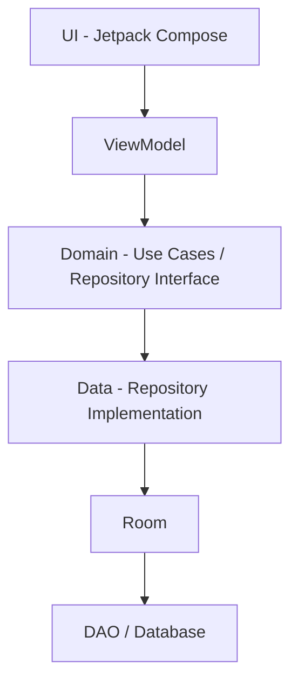

<div align="center">

# Voz Cidadã

**Uma plataforma digital para aproximar a população dos problemas e necessidades da comunidade.**


[Visão geral](#-sobre-o-projeto) · [Funcionalidades](#-funcionalidades) · [Tecnologias](#-tecnologias) · [Execução](#-como-executar)

</div>

---

## 📖 Sobre o projeto

O **Voz Cidadã** é uma aplicação Android que busca facilitar a participação cidadã, oferecendo um meio digital para registrar e organizar demandas relacionadas a problemas e necessidades da comunidade.

A proposta é centralizar manifestações como reclamações, sugestões e solicitações, contribuindo para uma comunicação mais organizada entre a população e os responsáveis pela gestão pública.

O projeto está sendo desenvolvido como parte de um **Projeto Integrado acadêmico**, com implementação progressiva de seu MVP.

## 🚨 Problemática

A população enfrenta dificuldades para expressar suas necessidades e participar efetivamente das decisões públicas. Manifestações podem ficar dispersas em diferentes canais, dificultando sua organização, identificação e análise. A falta de centralização também pode tornar mais difícil compreender quais problemas afetam a comunidade e acompanhar as demandas registradas.

## 💡 Solução proposta

O Voz Cidadã propõe uma aplicação que permite registrar demandas comunitárias em um único ambiente digital. Cada registro pode conter título, descrição, categoria e localização, além de informações de status e prioridade que integram o modelo de dados da aplicação.

A solução está em desenvolvimento e, nesta etapa, concentra-se no fluxo de cadastro, armazenamento local, consulta, filtragem e detalhamento das demandas.

## 🎯 Objetivos

- Facilitar o registro de problemas e necessidades da comunidade.
- Organizar manifestações por categorias.
- Permitir a consulta das demandas registradas.
- Estruturar informações que possam apoiar etapas futuras de análise e acompanhamento.

## ✨ Funcionalidades

### Implementadas no protótipo atual

- **Cadastro de demandas:** registro de título, descrição, categoria e localização opcional.
- **Validação:** impede o registro quando título ou descrição estão vazios.
- **Persistência local:** armazenamento das demandas usando Room.
- **Listagem:** visualização das demandas registradas.
- **Busca:** pesquisa de demandas por título.
- **Filtros:** filtragem por categoria e status.
- **Detalhamento:** visualização das informações de uma demanda selecionada.
- **Modelo de dados:** categorias, status e níveis de prioridade definidos no domínio.

### Planejadas / futuras

- Integração com backend para persistência remota e compartilhamento de dados.
- Recursos de Inteligência Artificial para apoiar interpretação, categorização ou priorização das manifestações.
- Acompanhamento mais completo do andamento das demandas.
- Painel ou recursos administrativos para análise das solicitações.

> Os itens futuros são propostas de evolução e não estão descritos como funcionalidades já implementadas.

## 📱 Demonstração

<!-- Adicione screenshots reais do aplicativo nesta seção. Sugestão: salve as imagens em docs/images/ e use Markdown, por exemplo:

<p align="center">
  
  
  
</p>

-->

_Screenshots serão adicionados conforme a evolução do protótipo._

## 🛠️ Tecnologias

| Tecnologia | Aplicação no projeto |
|---|---|
| [Kotlin](https://kotlinlang.org/) | Linguagem de desenvolvimento Android |
| [Jetpack Compose](https://developer.android.com/compose) | Construção da interface declarativa |
| [Material 3](https://m3.material.io/) | Componentes e padrões visuais |
| [Room](https://developer.android.com/training/data-storage/room) | Persistência local de dados |
| Android ViewModel | Gerenciamento de estado e lógica da interface |
| Coroutines | Execução de operações assíncronas |
| [Gradle](https://gradle.org/) | Configuração e build do projeto |
| [Git](https://git-scm.com/) / [GitHub](https://github.com/) | Controle de versão e colaboração |
| GitHub Actions | Automação de testes, lint e build |

## 🏗️ Arquitetura

O código está organizado em camadas, separando interface, regras de domínio e implementação de dados.



- **UI:** telas Compose, componentes de navegação e apresentação dos dados.
- **ViewModel:** coordena operações entre interface e domínio.
- **Domain:** modelos, contrato do repositório e casos de uso, incluindo validação e registro.
- **Data:** implementação do repositório e conversão entre modelos de domínio e entidades locais.
- **Room:** banco de dados local, DAO e entidade persistida.

## 📂 Estrutura do projeto

```text
AjudaCidadao/
├── app/
│   └── src/
│       ├── main/
│       │   ├── java/com/example/ajudacidado/
│       │   │   ├── data/
│       │   │   │   ├── local/        # Banco, DAO e entidades Room
│       │   │   │   └── repository/    # Implementação do repositório
│       │   │   ├── domain/
│       │   │   │   ├── model/        # Modelos, categoria, status e prioridade
│       │   │   │   ├── repository/    # Contrato do repositório
│       │   │   │   └── usecase/       # Casos de uso e validação
│       │   │   └── ui/                # Telas, ViewModel e tema
│       │   └── res/                    # Recursos Android
│       ├── test/                       # Testes unitários
│       └── androidTest/                 # Testes instrumentados
├── .github/workflows/                  # Workflow de CI
├── gradle/                             # Wrapper e catálogo de dependências
├── build.gradle.kts
├── settings.gradle.kts
└── README.md
```

## 🧪 Testes e integração contínua

O repositório possui um workflow do **GitHub Actions** que é acionado em pushes e pull requests direcionados à branch `main`.

O pipeline executa:

1. Testes unitários (`testDebugUnitTest`).
2. Android Lint (`lintDebug`).
3. Build de debug (`assembleDebug`).


## ⚙️ Como executar

### Pré-requisitos

- Android Studio.
- JDK compatível com a configuração Gradle do projeto (workflow utiliza JDK 17).
- Emulador Android ou dispositivo físico compatível (API 26 ou superior).

### Passos

1. Clone o repositório:

   ```bash
   git clone https://github.com/YuriHr3/Ajuda_Cidadao.git
   ```

2. Abra a pasta do projeto no Android Studio.
3. Aguarde a sincronização do Gradle.
4. Selecione um emulador ou conecte um dispositivo Android.
5. Execute a configuração `app`.

## 🗺️ Roadmap

- [x] Estrutura inicial da aplicação Android.
- [x] Interface de cadastro de demandas.
- [x] Persistência local com Room.
- [x] Listagem, busca e filtros.
- [x] Tela de detalhamento.
- [x] Testes unitários e pipeline de CI inicial.
- [ ] Refinamento visual e experiência de uso.
- [ ] Backend e persistência remota.
- [ ] Recursos de apoio por Inteligência Artificial.
- [ ] Expansão dos recursos de acompanhamento e análise.

## 👥 Equipe

- **Yuri de Lima Gomes**
- **Jefferson Yuri da Silva Ferreira**
- **Matheus Vinícius Niris do Nascimento**
- **Raphael Gutemberg da Silva Santos**

Projeto acadêmico desenvolvido como parte de um Projeto Integrado.

## 📄 Licença

Este projeto foi desenvolvido para fins acadêmicos. Uma licença de distribuição formal ainda não está especificada no repositório.

---

<div align="center">

**Voz Cidadã — tecnologia como ferramenta de participação social.**

</div>
